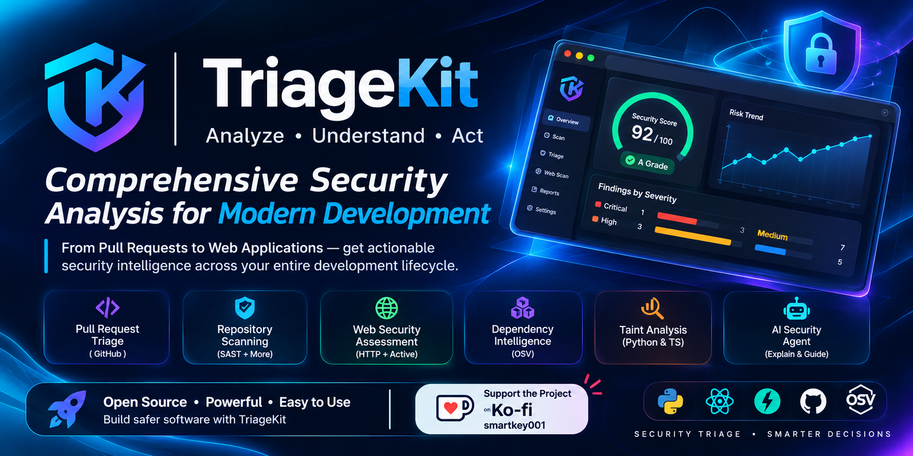
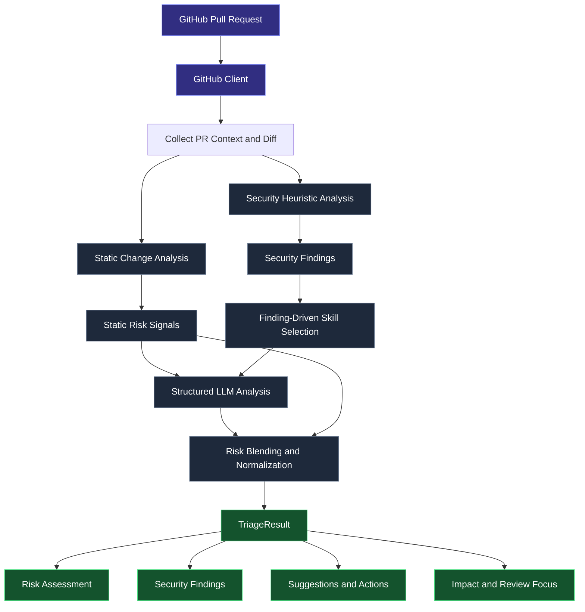
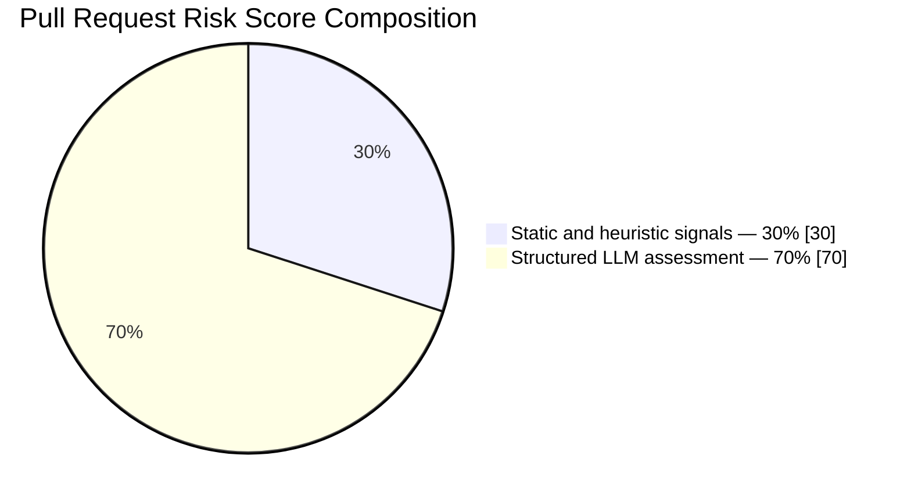
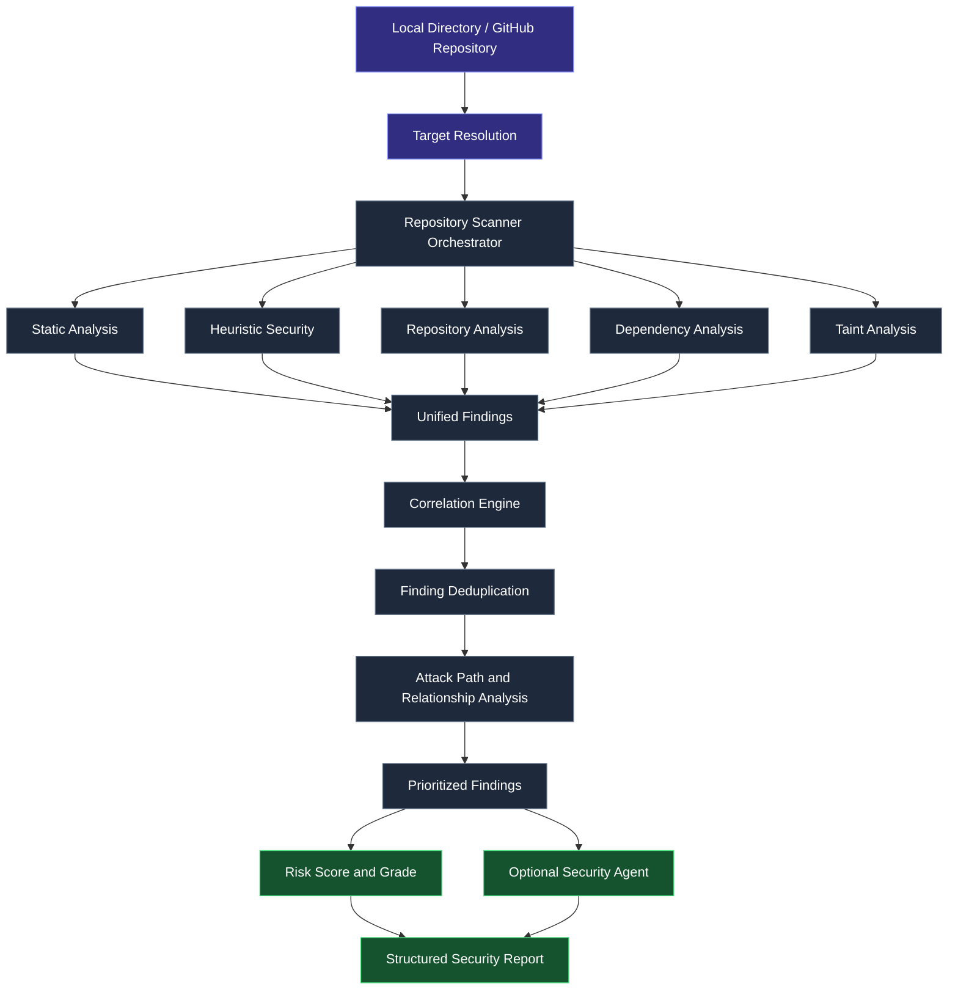
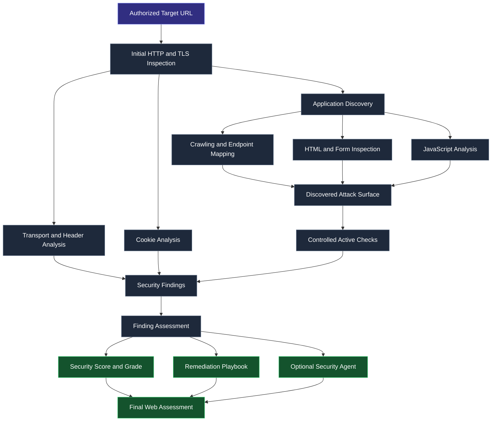
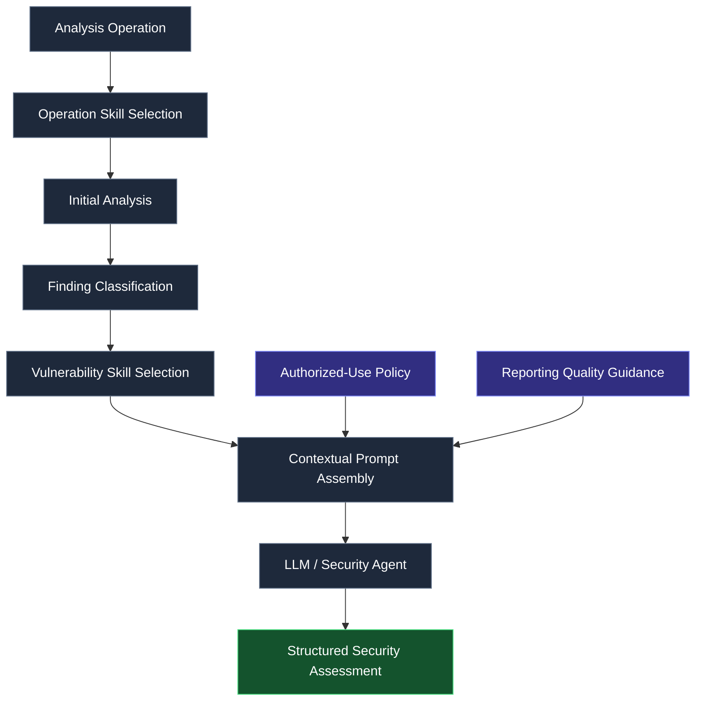
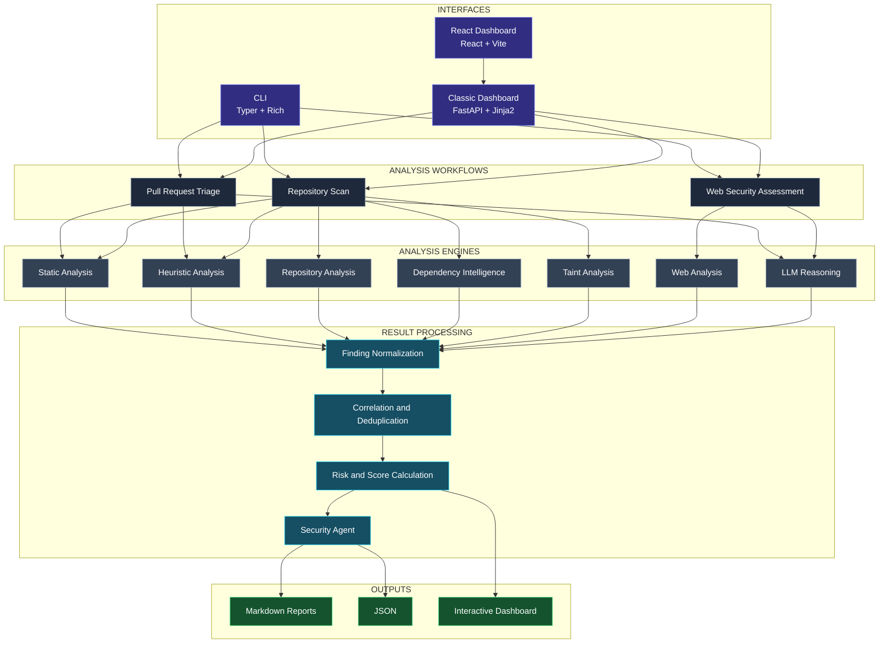
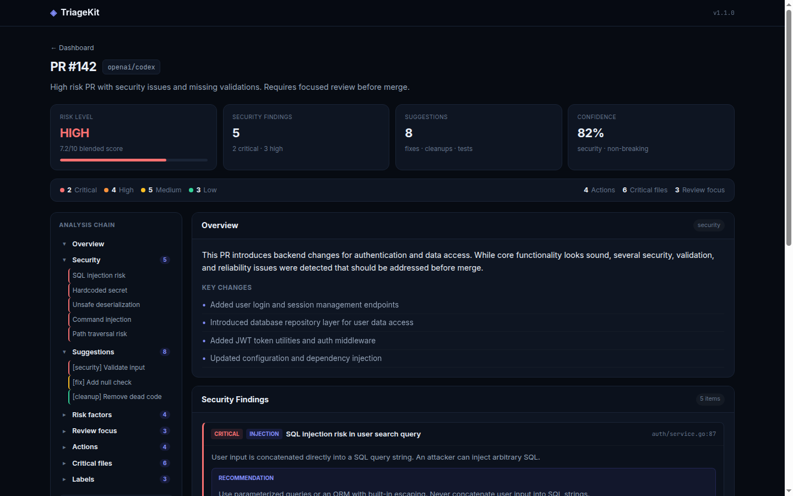
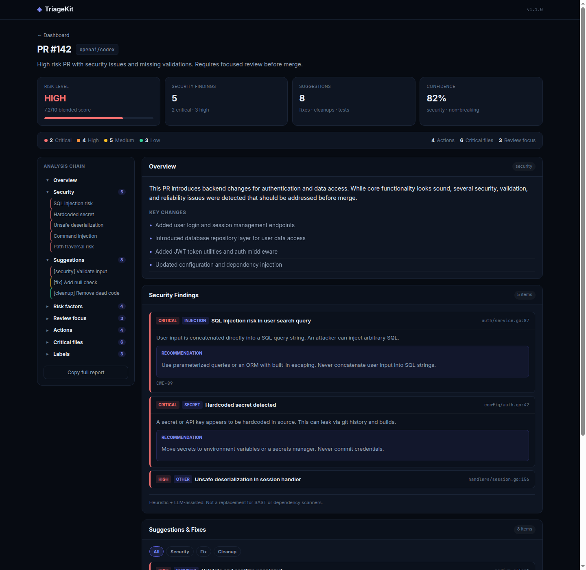

<div align="center">

# 🔥 TriageKit 🔥

<br>

### Advanced Security Triage & Code Intelligence

**Understand your code. Identify security risks. Prioritize what matters.**

TriageKit is an open-source security analysis platform combining static analysis, heuristic detection, taint analysis, dependency intelligence, web security assessment, and AI-assisted reasoning into a unified security workflow.

<br>

[](https://github.com/BYPASS-IDC/triagekit)
[](https://www.python.org/)
[](LICENSE)
[](#limitations)

<br>

[](https://github.com/BYPASS-IDC/triagekit/stargazers)
[](https://github.com/BYPASS-IDC/triagekit/forks)
[](https://github.com/BYPASS-IDC/triagekit/issues)
[](https://github.com/BYPASS-IDC/triagekit/commits)

<br>

[Overview](#overview) · [Features](#features) · [Architecture](#architecture) · [Installation](#installation) · [Usage](#usage) · [Documentation](#documentation) · [Support](#support--sponsorship)

<br>



</div>

---

## Overview

TriageKit is designed to make security analysis more contextual, structured, and actionable.

Traditional scanning tools often produce large collections of alerts without adequately explaining their relationships, their relevance to the application, or what developers should investigate first.

TriageKit approaches this problem through multiple analysis layers that work together to evaluate code changes, repository contents, dependencies, and exposed web applications.

Rather than treating every pattern match as an independent vulnerability, TriageKit uses standardized findings, correlation, severity classification, technical evidence, and contextual reasoning to produce more useful security reports.

### Three primary workflows

<table>
<tr>
<td width="33%" valign="top">

<div align="center">

**01**

### Pull Request Triage

</div>

Understand the security and operational implications of incoming changes.

- GitHub integration
- Static change analysis
- Diff-based security heuristics
- Risk assessment
- Structured AI reasoning
- Review prioritization

</td>
<td width="33%" valign="top">

<div align="center">

**02**

### Repository Analysis

</div>

Perform multi-layer security assessments against local projects and remote GitHub repositories.

- Repository-wide scanning
- Static and heuristic analysis
- Taint analysis
- Dependency intelligence
- Cross-layer correlation
- Security agent reporting

</td>
<td width="33%" valign="top">

<div align="center">

**03**

### Web Security Assessment

</div>

Investigate a web application's externally observable security posture.

- HTTP and TLS analysis
- Security headers
- Cookie inspection
- Attack-surface discovery
- JavaScript analysis
- Controlled active checks

</td>
</tr>
</table>

### Project capabilities

<div align="center">

| Component | Implementation |
|:---|:---:|
| Primary workflows | 3 |
| Registered scanner implementations | 6 |
| Repository scanning layers | 5 |
| Dedicated language rule packs | 6 |
| Taint-analysis language families | 2 |
| Dashboard implementations | 2 |
| Dependency intelligence | OSV |
| AI integration | OpenAI-compatible APIs |

</div>

These figures describe the implemented architecture, not a guarantee of detection coverage.

---

## Features

### 01. Pull Request Intelligence

A multi-stage PR analysis engine designed to help maintainers understand changes before they are merged.

TriageKit evaluates the structure and security implications of a pull request, combines deterministic analysis with structured LLM reasoning, and generates a report focused on review priorities.

**Analysis capabilities**

| Category | Description |
|---|---|
| Change Analysis | Modified files, additions, deletions, and change classification |
| Critical Paths | Security-sensitive and critical file detection |
| API Surface | Identification of exposed interfaces and relevant entry points |
| Security Heuristics | Injection patterns, secrets, weak cryptography, TLS, and related signals |
| Risk Assessment | Blended risk score, level, and contributing factors |
| Impact Analysis | User-facing changes, migration requirements, and rollback difficulty |
| Review Intelligence | Critical files, review focus, labels, and recommended actions |

**PR analysis output**

- Numerical risk score (0–10).
- Risk classification: LOW, MEDIUM, HIGH, or CRITICAL.
- Executive summary and one-line verdict.
- Structured security findings.
- Change impact assessment.
- Risk factors and supporting evidence.
- Suggested code improvements.
- Prioritized review recommendations.
- Critical files and suggested labels.
- Human-review and confidence indicators.

#### Pull Request Analysis Pipeline



#### PR Risk Model

The normal scoring path blends deterministic static analysis with the structured LLM assessment.



The resulting score determines the risk classification:

| Risk Level | Score |
|---|---:|
| LOW | Below 2.5 |
| MEDIUM | 2.5 – 4.9 |
| HIGH | 5.5 – 7.9 |
| CRITICAL | 8.0 – 10.0 |

The underlying implementation uses a blended score of `0.30 × static_score + 0.70 × llm_score`.

When LLM analysis is unavailable, TriageKit can return a static/heuristic-only fallback report and explicitly identify the partial assessment.

---

### 02. Repository Security Analysis

TriageKit includes a modular scanner framework that coordinates multiple security analysis engines.

The repository scanner examines source files, security-sensitive configurations, dependencies, and potential data-flow weaknesses.

Supported targets include:

- Local directories.
- Individual local files.
- Public GitHub repositories.
- Private GitHub repositories with appropriate access.
- Specific repository branches and references.

#### Scanner Architecture

| Scanner | Responsibilities |
|---|---|
| Static Analysis | Static security signals and language-specific rules |
| Heuristic Security | Pattern-based vulnerability identification |
| Repository Scanner | Repository-wide inspection and security checks |
| Dependency Scanner | Package identification and OSV advisory lookup |
| Taint Analysis | Source-to-sink data-flow analysis |

The sixth registered scanner is the dedicated web scanner, used for website security assessment.

#### Repository Analysis Flow



#### Finding Correlation

One underlying weakness can produce several signals across different analysis layers.

TriageKit includes a correlation engine to identify related findings, apply deduplication, and establish relationships between findings.

The unified finding model supports:

- Finding identifiers and scanner metadata.
- Severity and confidence.
- File paths and line numbers.
- Evidence and source snippets.
- CWE identifiers.
- Remediation recommendations.
- Fingerprints and correlation references.
- Finding status and suppression information.
- Analysis-layer attribution.

This distinction matters: a pattern match, a data-flow finding, an observed web probe, and a dependency advisory do not provide the same type of evidence.

---

### 03. Taint Analysis

TriageKit includes dedicated data-flow analysis for Python, JavaScript, and TypeScript.

Rather than relying exclusively on keyword or pattern matching, taint analysis attempts to trace potentially untrusted input through application code and identify paths leading to security-sensitive operations.

**Supported languages**

<div align="center">


</div>

| Analysis Component | Purpose |
|---|---|
| Sources | Identify potentially untrusted input |
| Sinks | Identify security-sensitive operations |
| Sanitizers | Recognize validation and sanitization operations |
| Data Flow | Follow values through supported analysis paths |
| Trace Analysis | Record relevant source-to-sink relationships |
| Findings | Report potential vulnerabilities with contextual evidence |

The engine includes dedicated Python and JavaScript/TypeScript analysis implementations, backed by a security source/sink registry.

---

### 04. Dependency Intelligence

Dependency analysis integrates with the [Open Source Vulnerabilities database (OSV)](https://osv.dev).

It identifies dependency manifests, extracts package information where supported, queries vulnerability advisories, and enriches relevant findings.

**Supported manifest and lockfile formats include:**

| Ecosystem | Formats |
|---|---|
| Python | `requirements.txt`, `Pipfile`, `Pipfile.lock`, `pyproject.toml` |
| JavaScript / TypeScript | `package.json`, `package-lock.json`, `npm-shrinkwrap.json`, `yarn.lock`, `pnpm-lock.yaml` |
| Go | `go.mod` |
| Rust | `Cargo.toml`, `Cargo.lock` |
| PHP | `composer.json`, `composer.lock` |
| Ruby | `Gemfile.lock` |
| Java | `pom.xml` |

Additional dependency manifests may be discovered for coverage reporting even when their format is not supported by the current parser.

**Dependency analysis pipeline**


Advisory enrichment can include:

- Vulnerability identifiers and aliases.
- Affected package and version information.
- Fixed-version information when available.
- CWE references and remediation guidance.
- CVSS vectors and reference links.
- Relevant ExploitDB and Metasploit references.

TriageKit does not interpret an unparsed manifest or an unavailable advisory response as proof that a dependency is secure.

---

### 05. Web Security Assessment

The web security adviser evaluates an application's externally observable security posture through passive inspection and controlled active checks.

The implementation is organized around six assessment areas.

| Assessment Layer | Capabilities |
|---|---|
| Transport & Edge | HTTPS, TLS, HSTS, cookies, CORS, and HTTP security headers |
| Attack Surface | Crawling, robots.txt, sitemap discovery, and JavaScript-extracted API hints |
| Exposure Discovery | Sensitive paths, backups, exposed resources, and information leakage |
| HTML & JavaScript | Forms, CSRF indicators, JavaScript sources and sinks, and hardcoded secrets |
| Active Checks | Reflection canaries, parameter checks, HTTP method probing, and soft-404 analysis |
| Security Guidance | Technology fingerprinting, advisory enrichment, and remediation playbooks |

#### Web Assessment Pipeline



Web scan results include:

- Target and final URL.
- HTTP status and network traces.
- Security findings and severity.
- Technology fingerprints.
- Discovered endpoints.
- Cookies and forms.
- JavaScript files and API hints.
- Recommended fixes.
- Security playbook.
- Optional AI-generated security brief.

**Authorization is mandatory.** Active checks must only be performed against systems you own or have explicit permission to assess.

---

### 06. AI Security Agent

The security agent adds a contextual reasoning layer to repository and web security assessments.

Its purpose is to help transform individual scanner findings into a structured understanding of the application's security posture.

**Agent capabilities**

- Executive security summaries.
- Attack-surface interpretation.
- Finding prioritization.
- Contextual vulnerability explanations.
- Remediation playbooks.
- Recommended priority fixes.
- Finding-specific technical guidance.

#### Automatic Skills System

TriageKit uses a skills system to provide operation-specific and vulnerability-specific instructions to the LLM.

Skills are selected automatically based on the current workflow and, where applicable, the findings produced by the analysis.



The skills catalog covers:

| Category | Examples |
|---|---|
| Core Procedures | PR triage, repository scanning, web assessment |
| Injection | SQL injection and command injection |
| Web Security | XSS, SSRF, path traversal, redirects |
| Authentication | Authentication and authorization weaknesses |
| Sensitive Data | Hardcoded secrets and credentials |
| Cryptography | Weak cryptography and TLS |
| Dependencies | OSV and supply-chain vulnerabilities |
| Exploit Intelligence | ExploitDB and external vulnerability references |
| Languages | Rust, PHP, JavaScript, and TypeScript guidance |
| Reporting | Finding narratives, false-positive control, report quality |
| Remediation | Prioritized fixes and verification guidance |

Explore the complete [Skills Index](skills/README.md).

---

## Architecture

TriageKit separates its interfaces, workflow orchestration, analysis engines, and reporting components.

### High-Level Architecture



### Core Design Principles

| Principle | Implementation |
|---|---|
| Static First | Establish deterministic signals before LLM interpretation |
| Layered Analysis | Combine independent scanning techniques |
| Structured Everything | Normalize findings into consistent models |
| Contextual Reasoning | Select relevant skills based on operation and findings |
| Correlation | Connect related signals and reduce duplicate reporting |
| Actionable Reporting | Provide evidence, recommendations, and remediation guidance |
| Honest Assessment | Clearly distinguish missing evidence from confirmed security |
| Responsible Usage | Preserve authorization boundaries for security testing |

---

## Dashboard

TriageKit provides a graphical interface for reviewing analysis results, security findings, risk indicators, and suggested actions.

### Dashboard Overview

<div align="center">



**Risk assessment · Security findings · Suggestions · Confidence · Analysis chain**

</div>

### Detailed Security Findings

<div align="center">



**Severity classification · Finding details · Recommendations · Review navigation**

</div>

<sub>These are illustrative dashboard captures; the embedded UI version may differ from the package version documented above.</sub>

### Available Interfaces

<table>
<tr>
<td width="50%" valign="top">

#### Classic Dashboard


The primary server-rendered interface.

- PR triage.
- Repository scanning.
- Website assessment.
- Interactive reports.
- Finding navigation.
- Remediation summaries.

</td>
<td width="50%" valign="top">

#### React Dashboard


An optional single-page interface.

- React 18.
- React Router.
- Vite development tooling.
- Shared FastAPI backend.
- Production assets served by FastAPI.

</td>
</tr>
</table>

---

## Technology Stack

TriageKit is built around a Python backend with a modular scanner architecture and an optional React frontend.

<div align="center">

### Backend & Core


### Frontend


### Integrations


</div>

### Core Dependencies

| Dependency | Purpose |
|---|---|
| Typer | Command-line interface |
| Rich | Terminal presentation and progress reporting |
| FastAPI | HTTP application and API |
| Uvicorn | ASGI application server |
| Pydantic v2 | Data validation and structured models |
| Pydantic Settings | Environment configuration |
| HTTPX | HTTP communication |
| PyGithub | GitHub integration |
| OpenAI Python SDK | OpenAI-compatible LLM communication |
| Jinja2 | Server-side dashboard templates |
| React 18 | Optional frontend application |
| React Router | Frontend navigation |
| Vite 5 | Frontend development and production builds |

---

## Installation

### Requirements

| Requirement | Details |
|---|---|
| Python | 3.9 or later |
| Git | Required for repository operations |
| GitHub Token | Recommended; required for authenticated/private repository access |
| LLM Provider | Required for full LLM-assisted analysis |
| Node.js and npm | Only needed for React frontend development |

### 1. Clone the Repository

```bash
git clone https://github.com/BYPASS-IDC/triagekit.git

cd triagekit
```

### 2. Create a Virtual Environment

**Windows**

```powershell
python -m venv .venv

.venv\Scripts\activate
```

**Linux / macOS**

```bash
python -m venv .venv

source .venv/bin/activate
```

### 3. Install Dependencies

Standard installation:

```bash
pip install -e .
```

Development installation:

```bash
pip install -e ".[dev]"
```

### 4. Configure Environment Variables

Copy the example configuration:

**Windows**

```powershell
Copy-Item .env.example .env
```

**Linux / macOS**

```bash
cp .env.example .env
```

Configure your `.env` file:

```env
# GitHub Integration
GITHUB_TOKEN=your_github_token

# LLM Configuration
LLM_API_KEY=your_api_key
LLM_BASE_URL=https://your-provider-endpoint/v1
LLM_MODEL=your_model_name

# Dashboard
TRIAGEKIT_HOST=127.0.0.1
TRIAGEKIT_PORT=8000
```

### LLM Provider Configuration

TriageKit uses an OpenAI-compatible API interface.

<details>
<summary><strong>OpenAI</strong></summary>

```env
LLM_API_KEY=sk-...
LLM_BASE_URL=https://api.openai.com/v1
LLM_MODEL=gpt-4o
```

</details>

<details>
<summary><strong>Ollama — Local Models</strong></summary>

Pull a model:

```bash
ollama pull llama3.2
```

Configure:

```env
LLM_API_KEY=ollama
LLM_BASE_URL=http://localhost:11434/v1
LLM_MODEL=llama3.2
```

</details>

<details>
<summary><strong>NVIDIA NIM</strong></summary>

```env
LLM_API_KEY=nvapi-...
LLM_BASE_URL=https://integrate.api.nvidia.com/v1
LLM_MODEL=your_available_model
```

</details>

<details>
<summary><strong>Ollama Cloud</strong></summary>

```env
LLM_API_KEY=your_ollama_cloud_key
LLM_BASE_URL=https://ollama.com/v1
LLM_MODEL=your_available_model
```

</details>

The preferred configuration variables are `LLM_API_KEY`, `LLM_BASE_URL`, and `LLM_MODEL`.

Legacy `OPENAI_API_KEY`, `OPENAI_BASE_URL`, and `OPENAI_MODEL` variables remain supported.

See [.env.example](.env.example) for the complete configuration template.

---

## Usage

TriageKit provides four primary CLI commands.

```text
triagekit
│
├── triage       GitHub Pull Request Analysis
├── scan         Repository Security Analysis
├── webscan      Website Security Assessment
└── serve        Web Dashboard
```

### 1. Pull Request Triage

Analyze a GitHub pull request:

```bash
triagekit triage 123 --repo owner/repo
```

Export structured JSON:

```bash
triagekit triage 123 --repo owner/repo --json
```

Override the GitHub token:

```bash
triagekit triage 123 --repo owner/repo --token YOUR_TOKEN
```

### 2. Repository Security Scan

Scan a local project:

```bash
triagekit scan ./my-project
```

Scan a public GitHub repository:

```bash
triagekit scan owner/repo
```

Scan a specific branch:

```bash
triagekit scan owner/repo@main
```

Alternatively:

```bash
triagekit scan owner/repo --branch develop
```

Export JSON:

```bash
triagekit scan owner/repo --json
```

**Available options**

| Option | Description |
|---|---|
| `--branch`, `-b` | Select a repository branch, tag, or reference |
| `--token`, `-t` | Override the GitHub access token |
| `--no-cve` | Skip OSV dependency lookup |
| `--max-files` | Maximum number of files to process (default: 8000) |
| `--json` | Export the complete structured result |
| `--agent` | Enable security-agent prioritization (default) |
| `--no-agent` | Disable security-agent prioritization |
| `--sarif` | Export scanner result records in a JSON envelope |

**Examples**

Skip dependency lookup:

```bash
triagekit scan ./my-project --no-cve
```

Disable the security agent:

```bash
triagekit scan ./my-project --no-agent
```

Limit file processing:

```bash
triagekit scan ./my-project --max-files 3000
```

The current `--sarif` option emits scanner result records in a JSON envelope. It should not be treated as a guarantee of full SARIF 2.1.0 compatibility.

### 3. Website Security Assessment

Assess an authorized target:

```bash
triagekit webscan https://example.com
```

Skip sensitive-path checks:

```bash
triagekit webscan https://example.com --no-paths
```

Disable AI security analysis:

```bash
triagekit webscan https://example.com --no-agent
```

Export JSON:

```bash
triagekit webscan https://example.com --json
```

### 4. Launch the Dashboard

Start the application:

```bash
triagekit serve
```

Open:

```text
http://127.0.0.1:8000
```

The default dashboard configuration is:

```env
TRIAGEKIT_HOST=127.0.0.1
TRIAGEKIT_PORT=8000
```

---

## Dashboard Development

The optional React interface shares the same FastAPI backend and analysis engines as the classic dashboard.

### Development Mode

Start the backend:

```bash
triagekit serve
```

Open a second terminal:

```bash
cd webui

npm install

npm run dev
```

Access the development frontend:

```text
http://127.0.0.1:5173
```

### Production Build

```bash
cd webui

npm install

npm run build
```

The frontend build is generated inside:

```text
src/triagekit/web/static/app/
```

Start the backend:

```bash
triagekit serve
```

Access the React application:

```text
http://127.0.0.1:8000/app/
```

---

## API Reference

TriageKit provides a FastAPI interface for its dashboard and external integrations.

### JSON API Endpoints

| Method | Endpoint | Description |
|:---:|---|---|
| `GET` | `/health` | Application health and version |
| `GET` | `/api/health` | API health and version |
| `POST` | `/api/triage` | Pull request analysis |
| `POST` | `/api/scan` | Repository security scan |
| `POST` | `/api/webscan` | Website security assessment |

The POST endpoints accept form-encoded parameters.

### Pull Request

`POST /api/triage`

| Parameter | Type | Required |
|---|---|:---:|
| `repo` | String | Yes |
| `number` | Integer | Yes |

### Repository Scan

`POST /api/scan`

| Parameter | Type | Required |
|---|---|:---:|
| `target` | String | Yes |
| `branch` | String | No |
| `no_cve` | Boolean-like | No |
| `no_agent` | Boolean-like | No |

### Website Assessment

`POST /api/webscan`

| Parameter | Type | Required |
|---|---|:---:|
| `url` | String | Yes |
| `no_paths` | Boolean-like | No |
| `no_agent` | Boolean-like | No |

### Example API Request

Repository scan:

```bash
curl -X POST http://127.0.0.1:8000/api/scan \
  -H "Content-Type: application/x-www-form-urlencoded" \
  --data-urlencode "target=owner/repo"
```

The API returns structured JSON containing findings, score information, summaries, and analysis metadata.

---

## Scoring & Reporting

Different workflows use different scoring models.

Understanding the distinction is important when interpreting reports.

### Pull Request Risk

The PR engine produces a blended risk score from 0 to 10.

| Risk Level | Threshold |
|---|---:|
| LOW | Below 2.5 |
| MEDIUM | 2.5–4.9 |
| HIGH | 5.5–7.9 |
| CRITICAL | 8.0–10.0 |

Static and heuristic signals contribute 30% of the blended score, while the structured LLM assessment contributes 70% when available.

### Repository Security Score

Repository scanning calculates a score from 100 by applying severity-based penalties to the findings.

| Severity | Penalty |
|---|---:|
| Critical | 18 |
| High | 8 |
| Medium | 3 |
| Low | 1 |

The score is calculated as:

```text
Score = max(0, 100 - Total Finding Penalties)
```

The resulting grade is:

| Grade | Score |
|:---:|---:|
| A | 90–100 |
| B | 75–89 |
| C | 60–74 |
| D | 40–59 |
| F | Below 40 |

### Web Security Score

Web assessment uses a separate finding-weighted model that also accounts for finding confidence.

| Severity | Base Penalty |
|---|---:|
| Critical | 20 |
| High | 9 |
| Medium | 4 |
| Low | 1 |

Confidence multipliers:

| Confidence | Multiplier |
|---|---:|
| High | 1.00 |
| Medium | 0.75 |
| Low | 0.45 |

The website must be reached and assessed before a score is treated as an assessment grade. An unsuccessful assessment is marked `N` rather than receiving an artificially reassuring grade.

**Important:** These scores are internal prioritization models. They are not CVSS scores, exploitability probabilities, or certifications of security.

### Output Formats

| Format | Purpose |
|---|---|
| Terminal | Human-readable CLI results |
| Markdown | Detailed reports and remediation guidance |
| JSON | Automation, scripts, integrations, and agents |
| Web Dashboard | Interactive report visualization |
| Scanner JSON Export | Scanner-level result records |

JSON examples:

```bash
triagekit triage 123 --repo owner/repo --json

triagekit scan owner/repo --json

triagekit webscan https://example.com --json
```

---

## Project Structure

```text
TriageKit/
│
├── src/
│   └── triagekit/
│       │
│       ├── cli.py
│       ├── api/
│       │   └── app.py
│       │
│       ├── core/
│       │   ├── engine.py
│       │   ├── scan_runner.py
│       │   ├── repo_fetch.py
│       │   ├── github_client.py
│       │   ├── llm.py
│       │   ├── output.py
│       │   ├── config.py
│       │   ├── prompts.py
│       │   ├── skills.py
│       │   ├── tree_view.py
│       │   │
│       │   ├── scanners/
│       │   │   ├── base.py
│       │   │   ├── orchestrator.py
│       │   │   ├── registry_init.py
│       │   │   ├── repo_scanner.py
│       │   │   ├── static_scanner.py
│       │   │   ├── heuristic_scanner.py
│       │   │   ├── dependency_scanner.py
│       │   │   ├── taint_scanner.py
│       │   │   ├── web_scanner.py
│       │   │   └── correlation.py
│       │   │
│       │   ├── analyzers/
│       │   │   ├── guards.py
│       │   │   ├── static.py
│       │   │   ├── repo_scan.py
│       │   │   ├── files_data.py
│       │   │   ├── security.py
│       │   │   ├── cve.py
│       │   │   ├── vuln_intel.py
│       │   │   ├── exploitdb.py
│       │   │   ├── exploit_relevance.py
│       │   │   ├── poc.py
│       │   │   ├── web_scan.py
│       │   │   └── security_agent.py
│       │   │
│       │   ├── taint/
│       │   │   ├── analyzer.py
│       │   │   ├── js_analyzer.py
│       │   │   ├── registry.py
│       │   │   └── models.py
│       │   │
│       │   ├── models/
│       │   │   └── results.py
│       │   │
│       │   └── web/
│       │       ├── templates/
│       │       └── static/
│       │
│       └── skills/
│
├── skills/
│   ├── 01-authorized-use.md
│   ├── 02-pr-triage.md
│   ├── 03-repo-scan.md
│   ├── 04-web-adviser.md
│   ├── ...
│   └── README.md
│
├── webui/
│   ├── src/
│   │   ├── api/
│   │   ├── components/
│   │   ├── pages/
│   │   └── styles/
│   ├── package.json
│   └── vite.config.js
│
├── tests/
│
├── testbench/
│   ├── fixtures/
│   ├── expected/
│   ├── scripts/
│   └── README.md
│
├── docs/
│   ├── screenshots/
│   ├── SECURITY_ARCHITECTURE.md
│   ├── SECURITY_INTEGRATION_AUDIT.md
│   ├── SECURITY_INTEGRATION_ROADMAP.md
│   ├── SECURITY_SKILLS_AND_PLUGINS_USAGE.md
│   └── internal/
│
├── .env.example
├── pyproject.toml
├── LICENSE
├── CONTRIBUTING.md
└── SECURITY.md
```

---

## Testing & Development

TriageKit includes automated tests and a dedicated scanner testbench.

### Install Development Dependencies

```bash
pip install -e ".[dev]"
```

### Run Automated Tests

```bash
pytest
```

### Run the Scanner Testbench

```bash
python testbench/scripts/run_testbench.py
```

The testbench uses local vulnerable and safe fixtures to validate scanner behavior.

Its included samples cover:

- Python.
- Rust.
- Swift.
- C#.
- C++.
- Java.

### Development Tools


TriageKit uses Ruff for linting and formatting support.

---

## Documentation

Additional technical documentation is maintained inside the repository.

| Resource | Description |
|---|---|
| [Security Architecture](docs/SECURITY_ARCHITECTURE.md) | Security architecture and analysis design |
| [Integration Audit](docs/SECURITY_INTEGRATION_AUDIT.md) | Security integration audit and findings |
| [Integration Roadmap](docs/SECURITY_INTEGRATION_ROADMAP.md) | Planned security integration improvements |
| [Skills & Plugins Usage](docs/SECURITY_SKILLS_AND_PLUGINS_USAGE.md) | Skills system and contextual guidance |
| [Skills Index](skills/README.md) | Available skills and authoring guidelines |
| [Testbench](testbench/README.md) | Local scanner fixture validation |
| [Contributing](CONTRIBUTING.md) | Development and contribution guidelines |
| [Security Policy](SECURITY.md) | Vulnerability reporting and responsible disclosure |

---

## Contributing

Contributions are welcome.

TriageKit is an evolving open-source security project. Improvements to the analysis engines, scanner framework, detection rules, integrations, documentation, and dashboard are valuable.

### Areas of Contribution

| Area | Potential Contributions |
|---|---|
| Static Analysis | New detection rules and improved language coverage |
| Heuristic Detection | Better vulnerability patterns and precision |
| Taint Analysis | Additional sources, sinks, sanitizers, and data-flow improvements |
| Dependency Intelligence | New package formats and advisory integrations |
| Web Security | Improved discovery and assessment checks |
| AI Reasoning | Better structured assessments and finding interpretation |
| Correlation | Improved deduplication and attack-path relationships |
| Dashboard | Interface improvements and visualization |
| Quality Assurance | Regression testing and false-positive reduction |

### Development Setup

```bash
git clone https://github.com/BYPASS-IDC/triagekit.git

cd triagekit

python -m venv .venv

pip install -e ".[dev]"
```

Activate your virtual environment before running the application.

### Run Validation

```bash
pytest

python testbench/scripts/run_testbench.py
```

### Contribution Guidelines

1. Keep changes focused and maintainable.
2. Add or update tests when scanner behavior changes.
3. Preserve the unified finding model.
4. Avoid introducing duplicate sources of truth for detection rules.
5. Keep root-level skills synchronized with their packaged copies under `src/triagekit/skills/`.
6. Never commit API keys, credentials, or `.env` files.
7. Follow the authorization policy when adding network or active-probing functionality.

Please read [CONTRIBUTING.md](CONTRIBUTING.md) before submitting a pull request.

---

## Security & Responsible Usage

TriageKit is intended for defensive security analysis and authorized testing.

**Only scan systems, applications, and repositories that you own or have explicit permission to assess.**

Some website assessment features perform active HTTP requests against the target.

Before conducting an assessment:

- Obtain authorization from the system owner.
- Understand the assessment scope.
- Respect testing restrictions and operational limits.
- Avoid accessing or modifying data outside the authorized scope.

### Reporting Vulnerabilities

For vulnerabilities affecting TriageKit itself, follow the responsible disclosure procedure in [SECURITY.md](SECURITY.md).

Please do not publish exploit details in public issues.

---

## Limitations

TriageKit is currently in **Beta**.

Automated security analysis has inherent limitations, and its findings must be interpreted in context.

- Static and heuristic analysis can produce false positives and false negatives.
- Taint analysis has narrower language coverage than general repository scanning.
- LLM-generated conclusions depend on the selected model and available context.
- Dependency results depend on supported manifests, package versions, and external advisory availability.
- Web assessments are limited by target accessibility and implemented checks.
- Some vulnerabilities require runtime validation or manual investigation.
- Analysis depth varies across programming languages, frameworks, and application architectures.

TriageKit distinguishes missing evidence from confirmed security issues.

A finding marked `NOT_ASSESSED` must never be interpreted as a clean result.

For comprehensive security assurance, combine TriageKit with human review, runtime testing, and specialized tools such as CodeQL, Semgrep, and professional penetration testing.

---

## Support & Sponsorship

TriageKit is developed as an independent open-source project.

Maintaining a security analysis platform requires continuous work on vulnerability detection, scanner reliability, language coverage, integrations, testing, and documentation.

If TriageKit is useful to your workflow, consider supporting its continued development.

### Why Your Support Matters

| Area | How Sponsorship Helps |
|---|---|
| Development | Continuous improvements and new capabilities |
| Security Research | Better detection rules and vulnerability analysis |
| Scanner Expansion | Broader ecosystem and language support |
| Reliability | Testing, regression prevention, and maintenance |
| Documentation | More complete technical resources |
| Open Source | Keeping the project accessible to developers |

<div align="center">

<br>

### Support TriageKit

**Help support the continued development of open-source security tooling.**

<br>

<a href="https://ko-fi.com/smartkey001">
  
</a>

<br><br>

[](https://ko-fi.com/smartkey001)

<br>

Every contribution helps fund the time and effort behind TriageKit's ongoing development.

<br>

</div>

Financial support is not the only way to contribute. You can also help by:

- Giving the repository a star.
- Reporting bugs and suggesting improvements.
- Contributing code and documentation.
- Sharing TriageKit with other developers.
- Helping improve scanner accuracy and reliability.

---

## License

TriageKit is released under the **MIT License**.

See [LICENSE](LICENSE) for the complete license terms.

---

<div align="center">

<br>

# TriageKit

### SECURITY TRIAGE. CONTEXTUAL ANALYSIS. ACTIONABLE INTELLIGENCE.

<br>

[](https://github.com/BYPASS-IDC/triagekit)
&nbsp;
[](https://ko-fi.com/smartkey001)
&nbsp;
[](CONTRIBUTING.md)

<br>

**Built for developers and maintainers who take software security seriously.**

<sub>TriageKit v0.9.0 · Open-source security analysis</sub>

<br>

</div>
